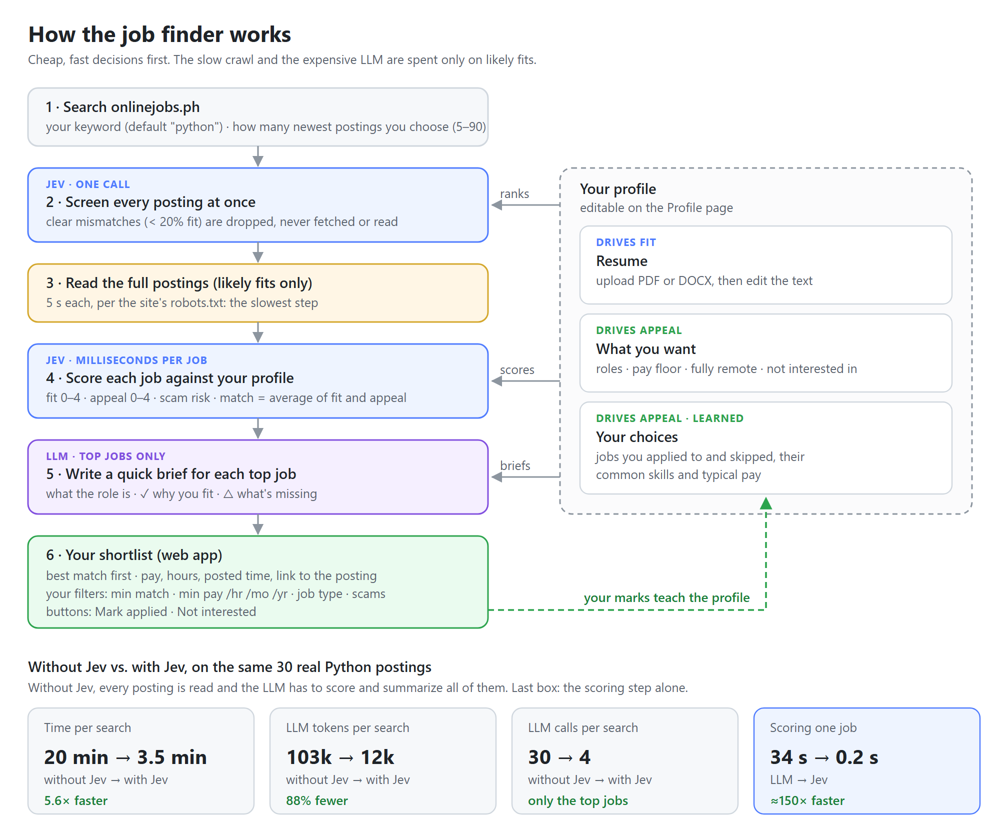

# Job Finder

A web app (FastAPI + React) for finding work on [onlinejobs.ph](https://www.onlinejobs.ph) and [JobStreet Philippines](https://ph.jobstreet.com). Pick a site, search, get a shortlist ranked against your resume and preferences, filter it, and mark what you apply to; the ranking learns from your marks. [Jev](https://docs.typesafe.ai) does the fast, cheap scoring, and an LLM writes short briefs for the top jobs only.




## How it works

1. **Search.** Scrape the newest postings for your keyword (default `python`) on the site you pick, or both, as many as you choose (5–90). With both sites the number is the total: results alternate site by site, so it splits about evenly, and if one site runs short the other fills in. The scraper waits 5 s between requests, as onlinejobs.ph's robots.txt asks; JobStreet gets the same delay. JobStreet's robots.txt only allows `?keywords` search URLs, and the app's paged `/{keyword}-jobs` URLs fall outside that, so JobStreet searches go beyond what its robots.txt permits.
2. **Jev screens.** One Jev call asks "is this a realistic fit?" for every search card at once. Clear mismatches (under 20%) are dropped and never fetched.
3. **Read.** Only the likely fits are fetched in full. At 5 s each, this is the slowest step, which is why step 2 matters.
4. **Jev scores** each job against your profile: **fit** 0–4 (would they hire you?), **appeal** 0–4 (would you want it?) and a scam signal. **Match** is the average of fit and appeal.
5. **The LLM writes a brief** for jobs matching 2.0 or higher: one line on the role, up to two ✓ reasons you fit, up to two △ gaps. The LLM's cost depends on how many jobs make the shortlist, not on how many are scanned.
6. **Your shortlist**, best match first, with pay, hours, posted time (local), the brief and a link to the posting.

## Your profile

The **Profile** page holds what every job is scored against:

- **Resume** (drives fit). Upload a PDF or DOCX, then edit the extracted text.
- **What you want** (drives appeal): roles, minimum pay (₱ or $, per hour/month/year), fully remote only, and what you're not interested in.
- **Learned from your choices** (drives appeal). *Mark applied* and *Not interested* are saved on the backend. The profile gains your recent applied and dismissed jobs, the skills common to jobs you applied to, and their typical pay, so ranking leans toward what you actually apply to. It can be switched off or cleared.
- **What Jev sees** shows the exact profile text being ranked against.

The profile starts from `profile.md` and is saved to `data/profile.json`; marks go to `data/marks.json`.

## Filters

On the Jobs page: minimum match, minimum pay (per hour, month or year), job type and hiding likely scams. Posted pay comes in many forms ("$20/hr", "6-8 Euros per hour", "₱60k/mo", "Negotiable"), so `pay.py` converts it to approximate USD per month and per hour. Hourly rates use each posting's own hours, so part-time jobs are compared fairly. Filters are remembered in the browser.

## Why Jev, not an LLM, for scoring?

`--no-jev` is a baseline where the LLM does Jev's job, scoring and summarizing every posting. On the same 30 real Python postings (Oct 14, 2026):

| | Without Jev | With Jev |
|---|---|---|
| Time per search | 1,183 s (20 min) | 213 s (3.5 min), 5.6× faster |
| LLM tokens | 102,941 | 11,947, 88% fewer |
| LLM calls | 30 | 4 |
| Scoring one job | ~34 s (LLM) | ~0.2 s (Jev), ≈150× faster |
| Shortlist | 7 jobs | 4 jobs, all among the LLM's 7 |

Jev's output is typed probabilities, so it can't come back malformed. The LLM's has to be parsed as JSON and range-checked. Jev costs $0.042 per million input tokens and output is free, which comes to well under a cent per search.

Caveats: this is a single run, and the LLM was a free model (`nvidia/nemotron-3-ultra-550b-a55b:free`) that also wrote briefs in the same call, so a fast paid model would narrow the time gap. Jev is stricter: the jobs only the LLM shortlisted sat just under the 2.5 default, one filter change away. Since then, briefs also cover jobs at 2.0–2.5, so a search makes a few more LLM calls than shown.

## Run it

Two terminals. The backend is FastAPI; the frontend is React + TypeScript (Vite) in `ui/`:

```bash
# Terminal 1: backend on http://127.0.0.1:8000 (API docs at /docs)
.venv\Scripts\activate
uvicorn ojagent.api:app --port 8000

# Terminal 2: frontend on http://localhost:5173
cd ui
npm install
npm run dev
```

Open http://localhost:5173. The dev server forwards `/api` to the backend. A search takes a few minutes because of the crawl delay. The progress bar shows each stage, survives a page reload, and only one search runs at a time.

| Endpoint | Purpose |
|---|---|
| `POST /api/runs` | Start a search: `{"keyword": "python", "postings": 30}` (5–90). Returns 409 if one is already running. |
| `GET /api/runs/{id}` · `GET /api/runs/active` | Progress (stage, done/total, elapsed), and results when done. |
| `GET /api/latest` | The most recent results, also saved as `out/latest.json`. |
| `GET` · `PUT /api/profile` | The editable profile, what's been learned from your marks, and the composed text Jev ranks against. |
| `GET` · `POST` · `DELETE /api/resume` | Show, upload (PDF/DOCX/TXT/MD, under 5 MB) or remove the uploaded resume. |
| `GET /api/marks` · `PUT /api/marks/{id}` · `DELETE /api/marks` | Applied / not-interested marks, each with a snapshot of the job to learn from. |

The same pipeline also runs without the UI and writes a Markdown report to `out/`:

```bash
python -m ojagent.triage                       # Jev screens and ranks, the LLM writes briefs
python -m ojagent.triage --no-jev              # baseline: the LLM scores and summarizes everything
python -m ojagent.triage --keyword fastapi --limit 45
python -m ojagent.triage --source jobstreet --keyword python
python -m ojagent.triage --source all --limit 60        # 60 in total, about 30 from each site
```

## Project layout

| Path | Responsibility |
|---|---|
| `ojagent/scraper.py` | Parses onlinejobs.ph search and detail pages; honours `Crawl-delay: 5`. Behind a `JobSource` protocol so tests can swap in fake postings. |
| `ojagent/jobstreet.py` | JobStreet Philippines client: reads the page state embedded in search and job pages. Uses `curl_cffi` with a Chrome fingerprint because Cloudflare blocks plain HTTP clients; never requests `/api/` or `/graphql`. |
| `ojagent/sources.py` | The searchable sites: label, client and per-run posting cap for each, plus `AllSites`, which searches both and interleaves the results. |
| `ojagent/prefilter.py` | Jev client: one call scores many items; retries on rate limits. Model pinned to `jev-1.13.0` so scores don't shift underneath you. |
| `ojagent/triage.py` | The pipeline: screen, fetch, score, rank, brief, with timings and token counts. Also a CLI. |
| `ojagent/api.py` | FastAPI backend: background runs with progress, resume upload and text extraction, profile and marks. |
| `ojagent/profile_store.py` | Editable profile seeded from `profile.md`, plus learning from applied / not-interested marks. |
| `ojagent/pay.py` | Free-text pay to approximate USD per month and per hour. |
| `ojagent/llm.py` | Thin client for any OpenAI-compatible API (OpenRouter, OpenAI, or local vLLM/Ollama). |
| `ojagent/models.py`, `config.py` | Posting models; settings from `.env`. |
| `ui/` | React + TypeScript frontend (Vite), dark mode: Jobs and Profile pages. |
| `profile.md` | The starting profile: preferences plus resume text. |

## Setup

```bash
python -m venv .venv && .venv\Scripts\activate      # Windows
pip install -r requirements.txt
copy .env.example .env
```

In `.env`:
- `TYPESAFE_API_KEY`: Jev, from [console.typesafe.ai](https://console.typesafe.ai/keys). Strongly recommended; without it the app falls back to the slow no-Jev mode.
- `LLM_API_KEY` (plus `LLM_BASE_URL` and `LLM_MODEL`): any OpenAI-compatible endpoint, for the briefs. Optional; without it, cards show the posting's opening lines.

At least one of the two keys is needed.

Then edit `profile.md` with your own details, or upload a resume on the app's Profile page.

## Tests

```bash
pytest
```

60 offline tests (no network) cover:
- HTML parsing against saved real pages, and the crawl delay
- the triage pipeline: fetching only what Jev keeps, the no-Jev baseline, fit + appeal ranking, briefs for top jobs only, the postings limit, JSON export
- the API: runs and progress, one run at a time, resume upload (PDF/DOCX/text), profile editing, marks and learning, input validation
- pay parsing across real posting formats, and profile seeding, composition and learning
- the Jev client against a mocked API: request shape and rate-limit retry
